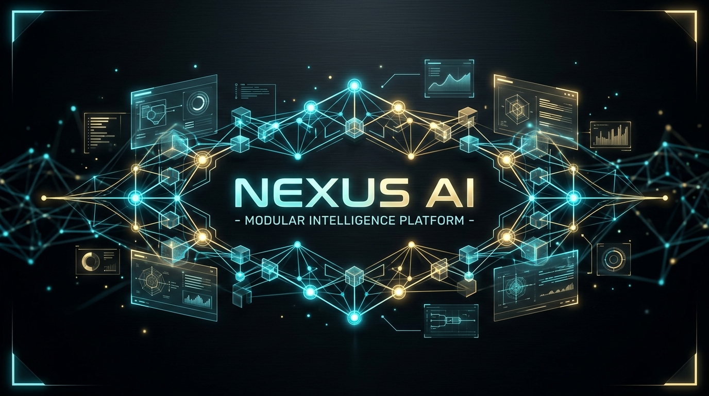
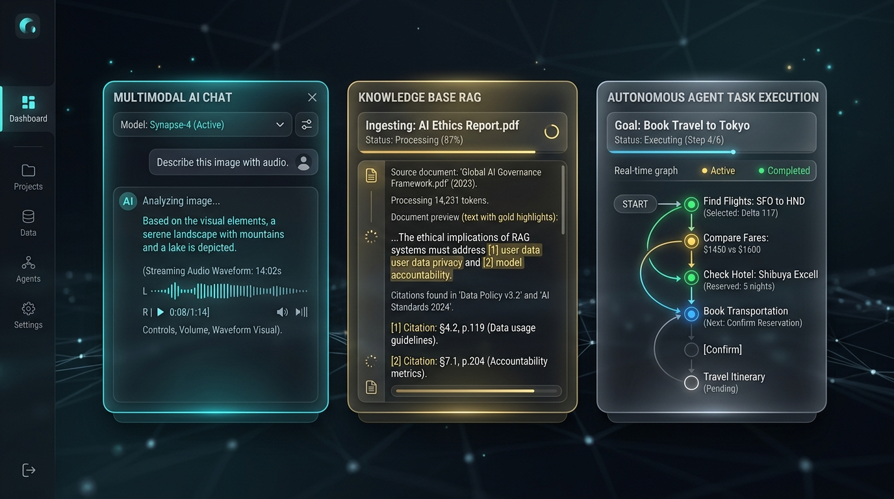
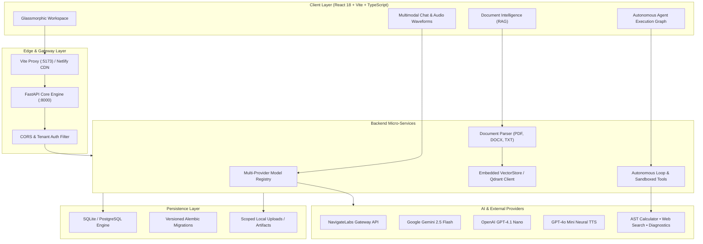

<div align="center">



# 🌐 NEXUS AI
### Production Modular Multimodal Intelligence Platform

[](backend/tests)
[](https://fastapi.tiangolo.com)
[](https://react.dev)
[](https://www.typescriptlang.org)
[](https://vitejs.dev)
[](https://www.netlify.com)
[](LICENSE)

<p align="center">
  <strong>An enterprise-grade, modular, multimodal AI workspace and autonomous agent platform.</strong><br>
  Built with high-throughput RAG document intelligence, multi-provider model routing, autonomous step-reasoning agents, neural speech synthesis, and a zero-dependency glassmorphic UI.
</p>

[Quickstart](#-quickstart--running-on-any-pc) • [Architecture](#-system-architecture--app-flow) • [Features](#-key-capabilities) • [Netlify Hosting](#-hosting-on-netlify) • [Documentation](#-project-structure)

</div>

---

## 🌟 Visual Showcase

<div align="center">



*Left: Multimodal Chat with Real-Time Audio TTS • Center: Knowledge Base RAG Ingestion • Right: Autonomous Agent Reasoning Graph*

</div>

---

## 🏛️ System Architecture & App Flow

NEXUS AI employs an asynchronous decoupled client-server architecture with dual-mode deployment:
- **Standalone Production Mode**: FastAPI serves the pre-compiled React SPA and API from a single unified server.
- **Microservices / Cloud Mode**: React SPA hosted globally on Netlify with API routed to remote FastAPI instances.



---

## ✨ Key Capabilities

### 1. 🤖 Multi-Provider AI Registry
- **Intelligent Routing**: Seamless switching between `gemini-2.5-flash`, `gpt-4.1-nano`, and `gpt-4o-mini-tts`.
- **Modality Support**: Text generation, vision understanding, neural TTS audio synthesis, and live SSE streaming.
- **Live Voice Playback**: Integrated browser Web Audio API + neural server synthesis.

### 2. 📚 Document Intelligence & Knowledge Base (RAG)
- **High-Fidelity Document Parsers**:
  - **PDF Parser**: Resilient parsing with `pypdf` handling multi-page academic & technical documents.
  - **DOCX Parser**: Comprehensive text extraction including **both paragraphs and tables** (`doc.tables`).
  - **Plaintext & Code**: Supports `.txt`, `.md`, `.csv`, `.json`, `.py`, `.ts`, `.html`.
- **Persistent Semantic Vector Store**:
  - Deterministic 128-dimensional embedding projection with cosine similarity + keyword overlap ranking.
  - Automatic database synchronization on server startup (`sync_from_db`).
  - Stopword filtering to ensure search matches subject keywords without noise.

### 3. 🧠 Autonomous Agent Execution Loop
- **Multi-Step Goal Resolution**: Given a high-level task, the agent decomposes objectives into discrete, bounded execution steps.
- **Sandboxed Tool Registry**:
  - `web_search`: Live search retrieval.
  - `calculator`: Secure AST mathematical computation.
  - `system_diagnostics`: Real-time platform health monitoring.
- **Auditability**: Every reasoning step, tool call, and observation is persisted to the database.

### 4. 🎨 Zero-Dependency Glassmorphic UI
- **Design Tokens**: Tailored HSL color palettes, subtle glowing micro-animations, and high-contrast typography.
- **Live Health Monitor**: Automatic backend connection detection with real-time status alerts.

---

## 🚀 Quickstart & Running on Any PC

### Option A: One-Click Windows Launcher (Fastest)
Double-click **`run.bat`** in the project folder.

---

### Option B: Command Line Launch
```bash
# Start both Backend and Frontend together with self-healing checks
python start_nexus.py
```

| Service | Local URL | Description |
| :--- | :--- | :--- |
| **Frontend Workspace (Dev)** | [http://localhost:5173](http://localhost:5173) | Vite Hot-Reload Development UI |
| **Unified Standalone App** | [http://127.0.0.1:8000](http://127.0.0.1:8000) | Single-Server Production App |
| **Interactive API Docs** | [http://127.0.0.1:8000/docs](http://127.0.0.1:8000/docs) | Swagger Interactive Documentation |
| **Platform Health Check** | [http://127.0.0.1:8000/api/health](http://127.0.0.1:8000/api/health) | Live Subsystem Diagnostic Endpoint |

---

## 🌐 Hosting on Netlify

NEXUS AI is fully configured for zero-friction Netlify hosting.

### Method 1: Instant Drag & Drop (30 seconds)
1. Open **[app.netlify.com/drop](https://app.netlify.com/drop)** in your browser.
2. Drag and drop **`netlify-deploy.zip`** (located in the repository root).
3. Netlify will immediately publish your live **React Chat Interface**.

### Method 2: Connect GitHub Repository (Continuous Deployment)
Connect this repository to Netlify. The included [`netlify.toml`](netlify.toml) configures everything automatically:
```toml
[build]
  base = "frontend"
  publish = "dist"
  command = "npm run build"

[[redirects]]
  from = "/*"
  to = "/index.html"
  status = 200
```

> **Note**: To connect your Netlify frontend to a remote backend API, add the environment variable `VITE_API_BASE_URL=https://your-backend-api.com/api` in Netlify Site Settings.

---

## 📦 Cross-PC Portability & Clean Packaging

To distribute NEXUS AI without machine-dependent binary errors (`.venv` or `node_modules` path locks):

```bash
python export_zip.py
```

This generates two clean, optimized archives:
- **`nexus-ai-portable.zip`** (~9 MB): Full-stack platform ready to unzip and run on any other PC via `run.bat`.
- **`netlify-deploy.zip`** (~70 KB): Production-compiled React frontend bundle for Netlify Drop.

---

## 🧪 Acceptance Test Suite

Run the full backend test suite:
```bash
cd backend
..\.venv\Scripts\python.exe -m pytest tests -v
```

```text
======================= test session starts =======================
tests/test_agents.py::test_list_agent_tools PASSED          [  9%]
tests/test_agents.py::test_execute_agent_task_with_trace    [ 18%]
tests/test_ai_engine.py::test_ai_models_and_capabilities    [ 27%]
tests/test_ai_engine.py::test_ai_chat_completion            [ 36%]
tests/test_ai_engine.py::test_reject_chat_on_pure_tts_model [ 45%]
tests/test_ai_engine.py::test_tts_audio_generation          [ 54%]
tests/test_auth.py::test_user_registration_and_login        [ 63%]
tests/test_conversations.py::test_conversation_lifecycle    [ 72%]
tests/test_documents_and_rag.py::test_document_upload_rag   [ 81%]
tests/test_health.py::test_health_check_returns_200         [ 90%]
tests/test_health.py::test_root_endpoint                    [100%]
======================= 11 passed in 49.15s =======================
```

---

## 📂 Project Structure

```text
NEXUS-AI/
├── .env.example             # Clean template configuration
├── .gitignore               # Excludes .venv, node_modules, .db, and secrets
├── README.md                # Comprehensive documentation & architecture guide
├── netlify.toml             # Netlify build & single-page routing configuration
├── run.bat                  # 1-Click Windows execution script
├── setup.bat                # Automated dependency installer
├── start_nexus.py           # Self-healing orchestrator with auto-dependency repair
├── export_zip.py            # Clean packager for cross-PC distribution & Netlify
│
├── backend/                 # FastAPI Asynchronous Core
│   ├── alembic/             # Versioned schema migrations
│   ├── app/
│   │   ├── api/routers/     # Health, Auth, Conversations, AI, RAG, Agents
│   │   ├── core/            # Database engine, config settings, security
│   │   ├── models/          # SQLAlchemy ORM data models
│   │   ├── providers/       # NavigateLabs, Gemini, OpenAI adapters & registry
│   │   ├── schemas/         # Pydantic validation schemas
│   │   ├── services/        # DocumentParser, VectorStore RAG, Agent loop
│   │   └── tools/           # Calculator, Web Search, Diagnostics
│   ├── requirements.txt     # Python dependencies
│   └── tests/               # Pytest acceptance test suite
│
├── frontend/                # React 18 + Vite + TypeScript Client
│   ├── public/              # Static assets & Netlify _redirects
│   ├── src/
│   │   ├── components/      # ChatView, DocumentWorkspace, AgentWorkspace, Sidebar
│   │   ├── services/        # Dynamic API client with offline diagnostics
│   │   ├── types/           # Strict TypeScript interfaces
│   │   ├── App.tsx          # Main layout orchestrator
│   │   └── index.css        # Premium dark glassmorphism design system
│   ├── package.json         # Node.js dependencies
│   └── vite.config.ts       # Reverse proxy configuration
│
└── docs/                    # Architecture diagrams & visual assets
    └── assets/              # High-resolution README graphics
```

---

## ⚙️ Environment Configuration (`.env`)

```ini
# Core
PROJECT_NAME="NEXUS AI"
ENVIRONMENT="development"
DEBUG=true
SECRET_KEY="your-production-secret-key"

# Database (Default: local SQLite database)
DATABASE_URL="sqlite:///./nexus.db"

# AI Provider Integration (NavigateLabs / Gemini 2.5 Flash / GPT-4.1)
NEXUS_API_BASE_URL="https://nexusapi.navigatelabs.ai"
NEXUS_API_KEY="your-api-key-here"

# Optional Direct Integrations
GEMINI_API_KEY=""
OPENAI_API_KEY=""
QDRANT_URL=""
QDRANT_API_KEY=""
```

---

## 📄 License

This project is licensed under the **MIT License** — see the [LICENSE](LICENSE) file for details.
